# Gullak

Gullak is an AI goal-savings planner, built as an Android prototype for the Paytm Build for India AI Hackathon. It
sits on top of mocked versions of Paytm Gold, Paytm Money and UPI AutoPay.

A user says a goal in Hindi, Hinglish or English: "Bhai ki shaadi, agle December tak, 50 hazaar". Gullak understands
it, asks one follow-up question if something is missing, and calculates daily, weekly and monthly options. It then
chooses where the money sits, explains why, and sets up AutoPay. When a debit fails, it offers ways to get back on track.

**AI understands and explains; code calculates and decides.** The model never produces an amount, date or product
choice that reaches the user unchecked, and it never moves money.

This is a demo. No real payment happens, and it is not affiliated with or endorsed by Paytm. The home screen is a
stand-in that shows where the feature would live.

| Paytm home | Talk to Gullak | Plan | AutoPay |
| --- | --- | --- | --- |
| 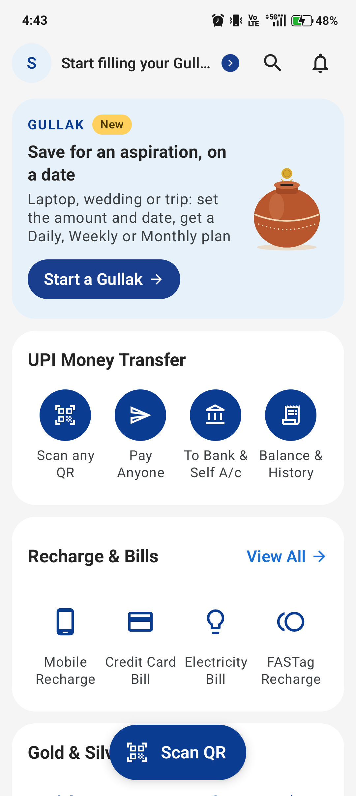 | 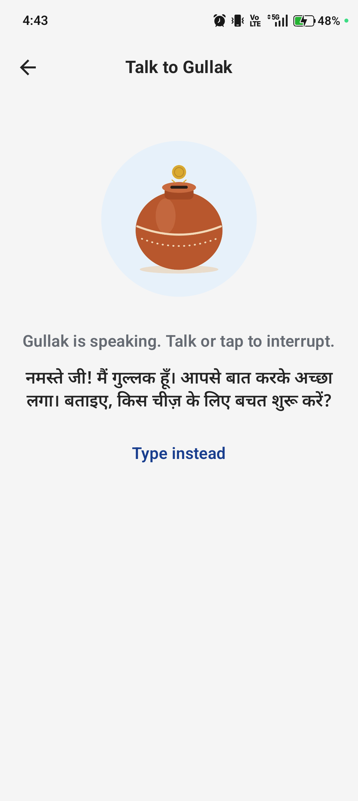 | 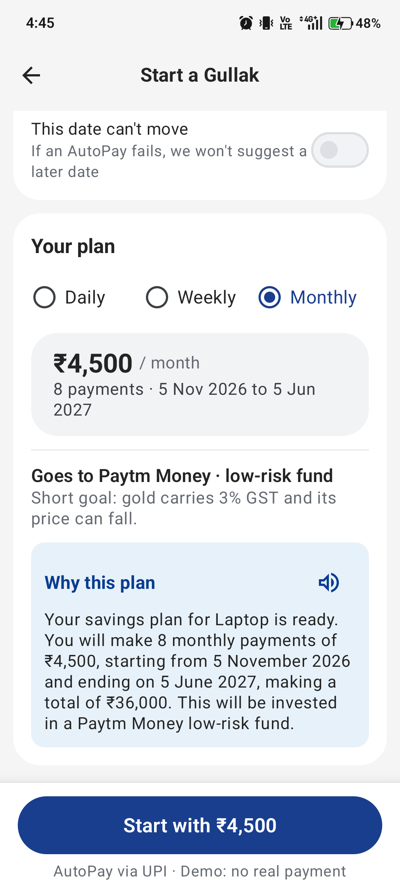 | 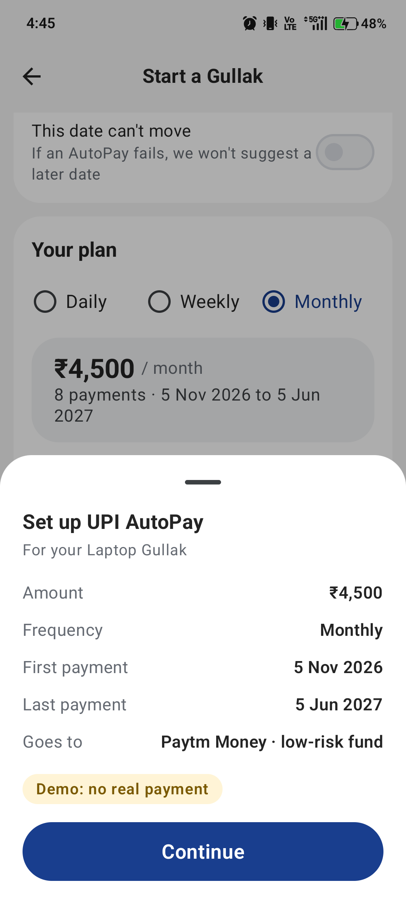 |

| Demo bank | Demo approval | Gullak started | Your Gullaks |
| --- | --- | --- | --- |
| 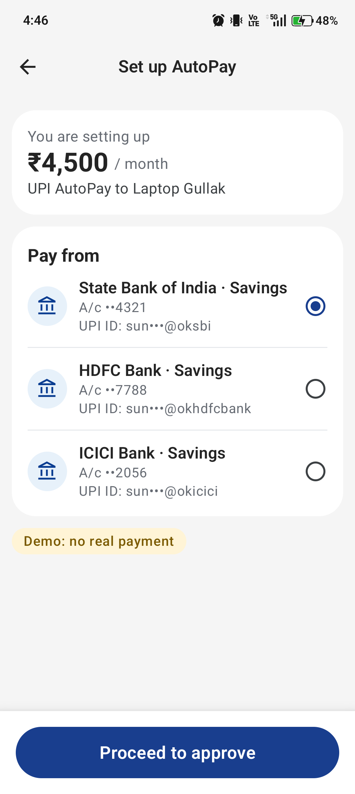 | 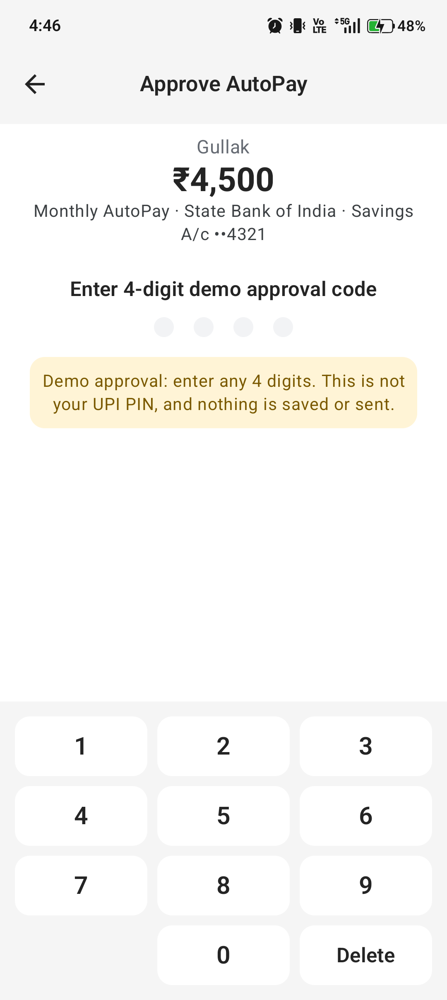 | 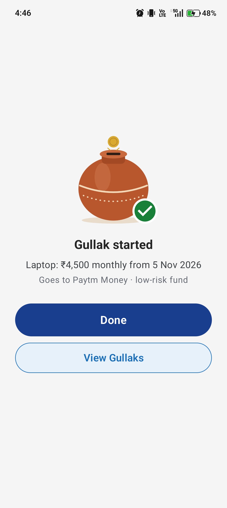 | 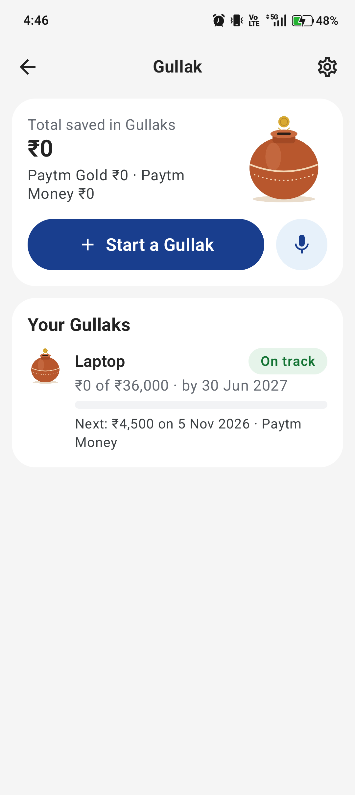 |

| Goal page | Recovery | Catching up | Back on track |
| --- | --- | --- | --- |
| 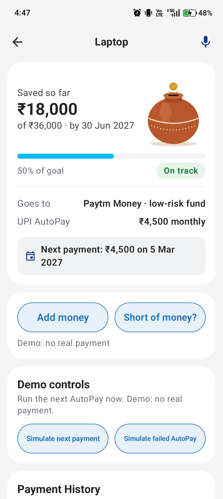 | 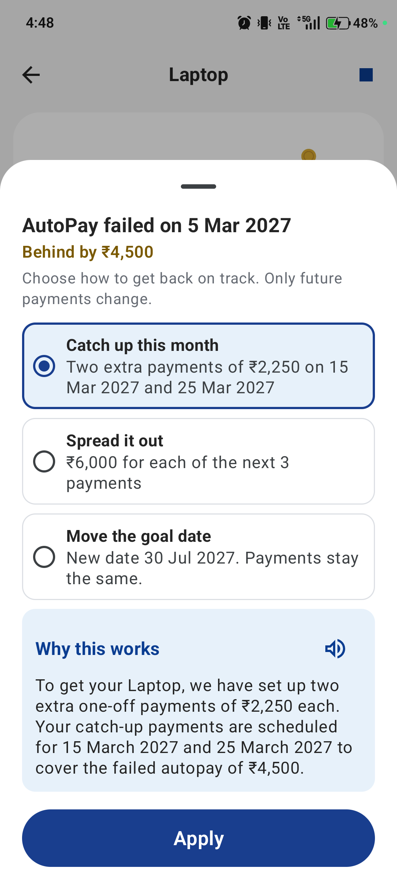 | 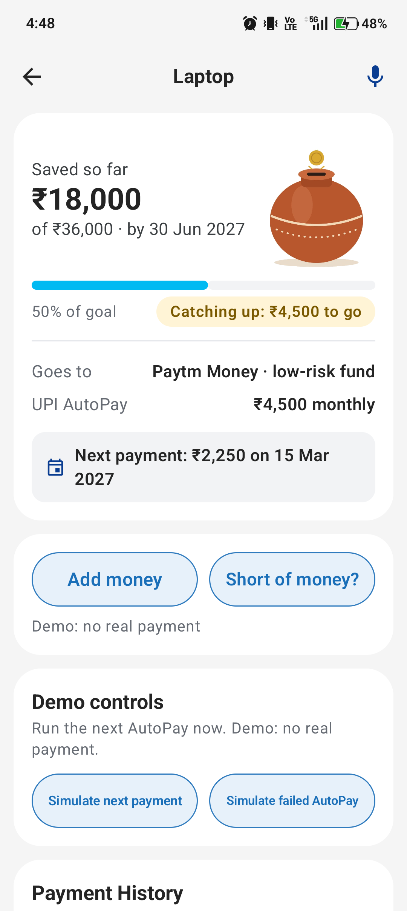 | 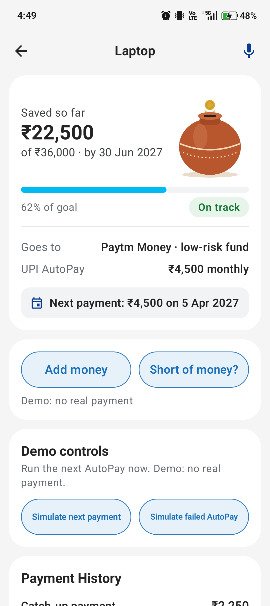 |

## Voice first

Starting a Gullak is a conversation, in Hindi, Hinglish or English:

> **Gullak:** Namaste! Bataiye, kis cheez ke liye paise jodne hain?
> **You:** Bhai ki shadi me 10 hazar dene hain, 15 March tak.
> **Gullak:** Achha, toh Bhai ki shadi ke liye ₹10,000, 15 March 2027 tak. Sahi hai?
> **You:** Haan.
> **Gullak:** Aap roz ₹50, ya har hafte ₹360, ya har mahine ₹2,000 bacha sakte hain. Kaunsa aasan lagega?
> **You:** Mahine wala.
> **Gullak:** Aapke SBI khate se AutoPay shuru kar doon? Yeh demo hai, asli paisa nahi katega.
> **You:** Haan, kar do.

(The amounts above only show the shape of the talk; the app's come from `PlanEngine`.)

[Sarvam](https://www.sarvam.ai) provides the ears and voice: Saaras over a WebSocket for speech to text, Bulbul for text
to speech. Without a Sarvam key, Gemini's voice speaks and the phone's recogniser listens; without a connection, the phone
does both. With Sarvam on, microphone audio is sent to Sarvam; spoken lines go to whichever voice is used. Nothing else
from the phone is sent.

On a running Gullak you can add money any time, ask for your money on goal day, and ask about a top-up if you are short.
The top-up only appears if you ask, only for the gap, and only after a few payments: it is a mock with no lender behind it,
it sends nothing and it never quotes terms.

The goal page talks too. When an AutoPay fails, Gullak says what happened and offers the recovery plans aloud; you pick
one by talking and it is applied on your yes. The mic button there says how the goal is doing.

## Flow

1. **Paytm home:** Gold & Silver card, then "Gullak". Only Gullak works; other tiles say so.
2. **Goal form:** name, amount, optional one-time payment, date. The mic fills the form through the AI.
3. **Plan:** Daily, Weekly or Monthly with the amount, where the money goes, and why.
4. **AutoPay:** mandate summary, demo bank account, demo approval code, processing, success.
5. **Goal detail:** progress jar, payment history, demo controls and recovery plans after a failed debit.

## Architecture

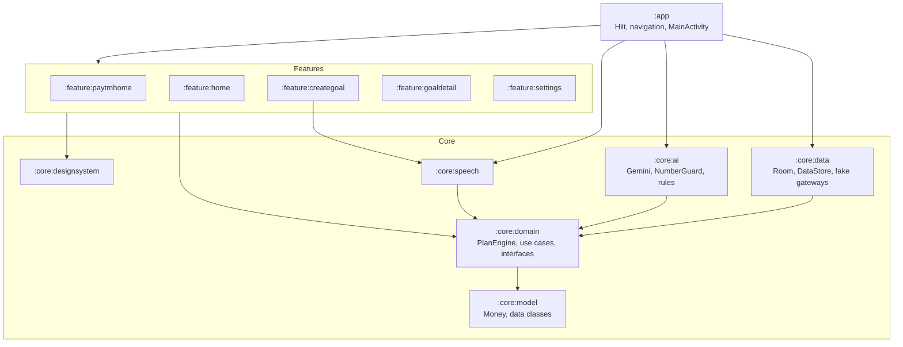

- `:core:model` and `:core:domain` are pure Kotlin with no Android imports.
- Features never depend on each other, `:core:data` or `:core:ai`. `:app` wires navigation between them.
- Implementations are bound with Hilt `@Binds`; their interfaces live in `:core:domain`.
- Each screen is MVVM with one direction of data: one `ViewModel`, one immutable `UiState`, events through `onEvent`.
- Build configuration lives in `build-logic` convention plugins, and versions in `gradle/libs.versions.toml`.

## How the AI is used and guarded

| Job | Who does it | Guard |
| --- | --- | --- |
| Reading a spoken goal | Gemini, with a JSON response schema | Falls back to `RuleBasedGoalParser` on any failure |
| Amounts, dates, schedule, destination | `PlanEngine` (no AI) | Unit tests with Kover coverage |
| Explaining a plan | Gemini | `NumberGuard`: any number not in the plan input discards the reply for a string template |
| Moving money | Nobody: AI has no access to it | Gateways are only called by use cases after the user approves |

Understanding chain: demo mode uses a saved answer from `DemoAiResponses` if the sentence matches with the same numbers
and months; otherwise Gemini, then `RuleBasedGoalParser` on any failure. Settings shows which path read the last goal.

After reading a spoken goal, Gullak reads it back from checked values and listens: yes reads the explanation, no asks
what to change, and anything else is taken as a correction.

Explanations come in the language the user spoke: English, Hinglish or Hindi. Voice replies read follow-up questions
and explanations aloud with Android text-to-speech, and can be turned off in Settings. After a follow-up question the
mic listens again for the answer. Only the transcript text is sent to the model.

## What is mocked

| Mocked | Interface | Fake |
| --- | --- | --- |
| Paytm Gold, Paytm Money | `SavingsDestinationGateway` | `DemoSavingsDestinationGateway` |
| UPI AutoPay | `AutoPayGateway` | `DemoAutoPayGateway` |
| Date | `DemoClockController` | `DemoClock` |

To use real Paytm APIs, implement those interfaces and change the bindings in `core/data/.../di/DataModule.kt`. Nothing
else in the app knows they are fake.

The bank and approval screens are demo stand-ins too. The approval screen is deliberately labelled and is not a copy of
the UPI PIN screen: it only counts four digits, and nothing is saved or sent. A real UPI PIN would be entered in the
bank or NPCI flow, never inside Gullak.

## Try the APK

[`apk/Gullak-demo.apk`](apk/Gullak-demo.apk) is a debug build for Android 8.0 or newer. It holds no API keys, so it runs on the
offline goal parser, written explanations and the phone's own voice. Gemini and Sarvam need a build with your own keys, as below.

## How to run

You need JDK 17 and the Android SDK. Copy `local.properties.example` to `local.properties` and set:

```properties
sdk.dir=/path/to/Android/Sdk
GEMINI_API_KEY=your-key
GEMINI_MODEL_ID=gemini-3.5-flash-lite
SARVAM_API_KEY=your-key
```

The app runs without a key: demo mode needs none, and outside demo mode it falls back to the offline rules.

```bash
./gradlew :app:installDebug
```

```bash
./gradlew check
```

```bash
./gradlew :app:assembleRelease
```

```bash
./gradlew :core:domain:koverHtmlReport
```

`check` runs unit tests, ktlint, detekt and Android lint. `DemoPathUiTest` walks the real app and Hilt graph from the
Paytm home to goal detail under Robolectric, so it needs no device. Speech and spoken replies are not covered by it.

**A key in `BuildConfig` can be read out of the APK.** A shipped app would call the model through a backend, never with
a key in the APK. Do not share an APK built with a key you want to keep, including the release build. Build it with
`GEMINI_API_KEY` empty if it will leave your hands.

## Demo mode

Demo mode is on in Settings by default. It uses saved AI answers and template explanations, so it works offline, and it
pins the date to 31 Oct 2026 so the worked examples are what you see.

| Goal | Daily | Weekly | Monthly |
| --- | --- | --- | --- |
| Laptop, ₹36,000, 30 Jun 2027 | ₹155 | ₹1,060 | ₹4,500 |

To demo a recovery:

1. Open **Settings › Reset** first, to clear old goals and return to the demo date.
2. Open a goal and tap **Simulate next SIP** a few times, then **Simulate failed AutoPay**.
3. Tap **Fix plan** and choose a recovery plan.

Settings also fast-forwards the date (due SIPs post on the way), resets to an empty home or to two seeded goals, and
sets the app and speech languages.

## Test sentences

Today is taken as 31 Oct 2026. These are saved in `DemoAiResponses`.

| # | Input | Expected |
| --- | --- | --- |
| 1 | Bhai ki shaadi, agle December tak, 50 hazaar | 50000, 2027-12-31 |
| 2 | Goa trip in March, 30,000 | 30000, 2027-03-31 |
| 3 | Beti ki school fees, April mein, 45 hazaar | 45000, 2027-04-30 |
| 4 | Mujhe naya phone lena hai | follow-up asks amount and date |
| 5 | Laptop for my son, 36000, by June | 36000, 2027-06-30 |
| 6 | Diwali ke liye 20 hazaar | 20000, no date, hint Diwali |
| 7 | 6 mahine baad Goa jaana hai, 30 hazaar | 30000, 2027-04-30 |
| 8 | Bike ke liye dedh lakh, 2 saal mein | 150000, 2028-10-31 |
| 9 | Emergency fund banana hai, 1 lakh | 100000, follow-up asks by when |
| 10 | मुझे अगले साल मई तक 25000 बचाने हैं | 25000, 2027-05-31 |
| 11 | Kuch paise bachane hain | follow-up asks what for |
| 12 | Maa ka birthday gift, 5000, 15 January | 5000, 2027-01-15 |

## Known limitations

- Every Paytm service is a fake, so nothing about real mandates, settlement or KYC is exercised.
- The Gemini and Sarvam keys are in the APK (see above). A real product needs a backend.
- Saying yes is the demo's approval. A real UPI AutoPay mandate needs the customer's UPI PIN in the bank or NPCI flow.
- Talking over Gullak to interrupt it relies on the phone's echo cancelling, which varies by phone. In a noisy room, turn
  it off in Settings and tap the jar instead. The first words said while interrupting can be missed by the recogniser.
- With Gemini's voice each line takes a few seconds to arrive, and a rate-limited free key drops to the phone's voice for
  a minute. Sarvam or a paid key avoids this.
- Speech uses the phone's speech recogniser inside the app, and falls back to the phone's own speech screen if the
  recogniser is unavailable. Recognition is not forced offline, so it may need a network.
- Spoken replies use the phone's text-to-speech engine. Without a Hindi voice the engine's current voice reads them, and
  Gullak shows a one-time hint pointing to the settings.
- The app is light theme only, to match Paytm.
- `festivals.json` covers 2026 and 2027 only.
- No TalkBack or 200% font audit has been done.
- The app has been tested on one real phone. The release build has been built but not run on a device.
